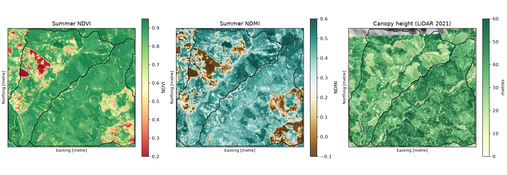
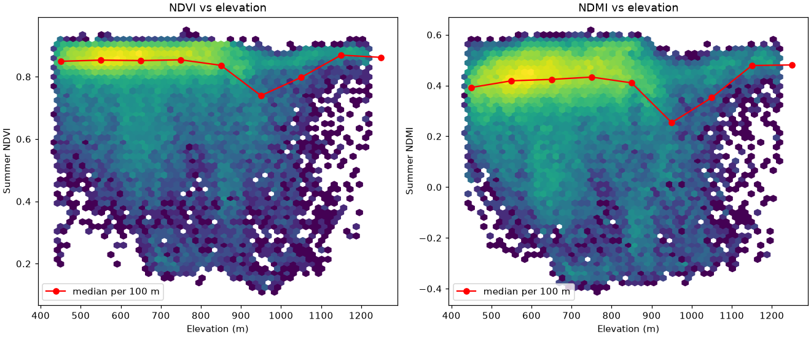
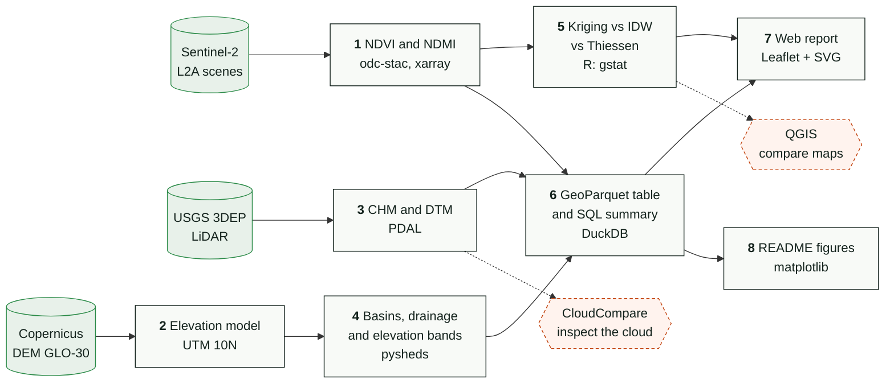
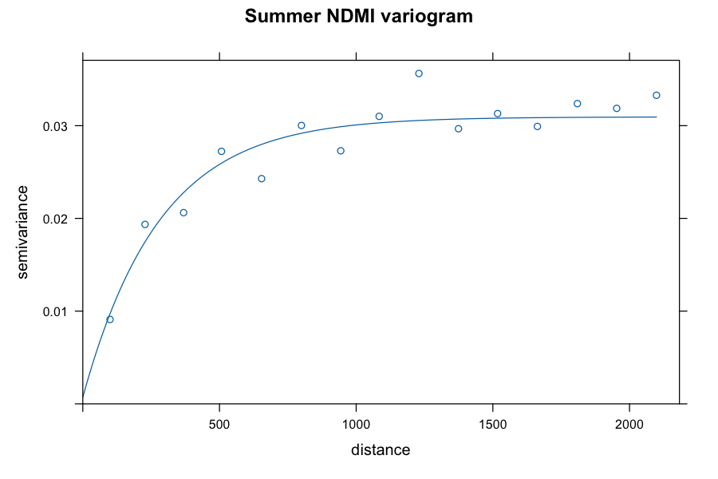
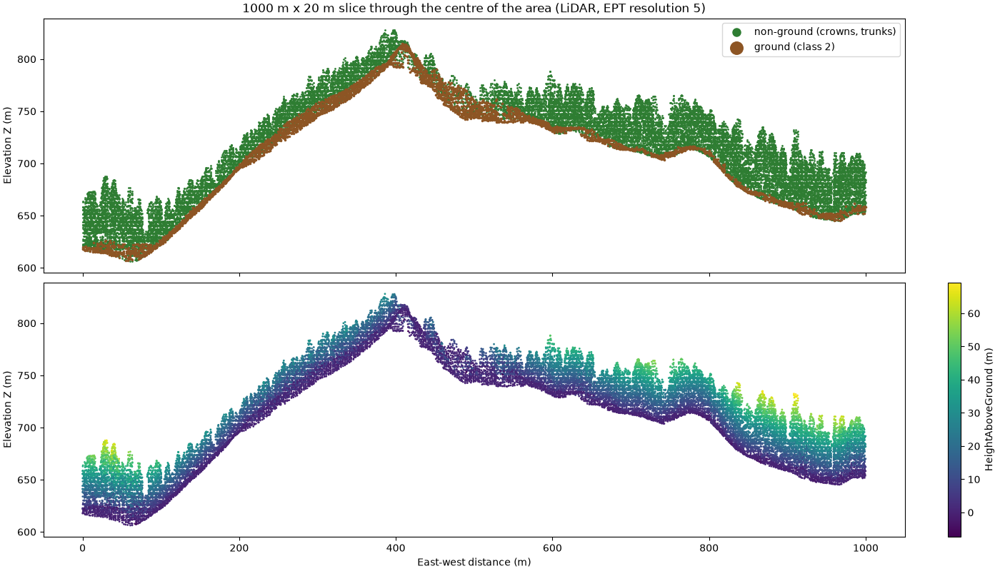

# Andrews Watershed: vegetation, moisture and canopy height with open tools


An end-to-end remote sensing and GIS workflow built only with free software and public data.
It measures how greenness (NDVI), leaf water content (NDMI) and canopy height (LiDAR) change with
elevation inside two forested mountain watersheds in the Oregon Cascades, USA, and ends in a
scroll-through web report.

**[Read the interactive report](https://100founts.github.io/open-geospatial-pipeline/)**



## The finding

Greenness does not fall steadily with elevation. In almost every 150 m elevation band the mean NDVI stays
between 0.78 and 0.83, but in the **900–1,050 m band it drops to 0.68**, and NDMI nearly halves
(0.20 against 0.35–0.39). A straight line cannot describe a localised drop, which is why the overall
correlation with elevation is weak (−0.21).

The 2021 LiDAR shows the same ~38 m canopy in that band as in the others, so the trees were standing when
the aircraft flew. The most likely explanation is greenness lost afterwards (clear-cutting or another
disturbance). That is a hypothesis: confirming it would take a multi-year image series or harvest maps.



| Band | Pixels (20 m) | NDVI | NDMI | Mean canopy (m) | Canopy p95 (m) |
|---|---:|---:|---:|---:|---:|
| 300–450 m | 383 | 0.797 | 0.354 | 31.1 | 54.6 |
| 450–600 m | 14,905 | 0.828 | 0.388 | 36.4 | 56.3 |
| 600–750 m | 16,390 | 0.798 | 0.362 | 37.6 | 55.0 |
| 750–900 m | 10,696 | 0.784 | 0.349 | 37.5 | 55.0 |
| **900–1,050 m** | **3,364** | **0.677** | **0.195** | **37.8** | **54.9** |
| 1,050–1,200 m | 1,261 | 0.784 | 0.361 | 39.0 | 49.9 |
| 1,200–1,350 m | 120 | 0.843 | 0.448 | 35.6 | 50.6 |

Bands with fewer than 500 pixels (the first and the last) give unstable averages.

## The pipeline



Dashed boxes are manual review steps, not scripts.

| Step | Script | What it does | Main tools |
|---|---|---|---|
| 1 | `01_sentinel2.py` | Finds 2025 scenes with under 40 % cloud, reads only the area's pixels, masks clouds with the SCL layer, computes NDVI/NDMI per date, monthly medians and a July–September mean. Ends with a control pixel recomputed by hand. | pystac-client, odc-stac, xarray, Zarr, COG |
| 2 | `02_dem.py` | Copernicus GLO-30 elevation (30 m), reprojected to UTM 10N. | STAC, rioxarray |
| 3 | `03_lidar.py` | Five chained PDAL pipelines: download 3DEP points, remove noise and classify ground (SMRF), height above ground, a thinned sample for viewing, CHM and DTM. | PDAL, rasterio |
| 4 | `04_hydrology.py` | Fills pits and depressions, D8 flow direction and accumulation, delineates the two largest basins, extracts the drainage network and 150 m elevation bands. | pysheds, geopandas |
| 5 | `05_kriging.R` | Samples 300 NDMI points as if they were field sensors, holds out 20 %, fits a variogram and compares kriging, IDW and Thiessen polygons. Moran's I for spatial autocorrelation. | terra, sf, gstat, spdep |
| 6 | `06_duckdb_summary.py` | Joins NDVI, NDMI, elevation, canopy height and band into one 20 m GeoParquet table and summarises it with SQL. | GeoParquet, DuckDB |
| 7 | `07_web_report.py` | Rasters to Web Mercator PNG, vectors to GeoJSON, metrics to JSON for the report in `docs/`. | matplotlib, Leaflet |
| 8 | `08_figures.py` | The static figures in this README. | matplotlib, PDAL |

Shared, testable logic lives in `scripts/common.py`; the numbered scripts only download, call it and save.

## Interpolation: kriging wins, but only just

300 NDMI pixels were sampled as if they were sensors; 20 % were held out and each method was scored on the
60 points none of them saw.

| Method | RMSE | MAE | Bias |
|---|---:|---:|---:|
| Kriging | **0.1418** | 0.0967 | 0.0363 |
| IDW | 0.1445 | 0.1002 | 0.0346 |
| Thiessen | 0.1874 | 0.1227 | 0.0398 |

Kriging beats IDW by about 2 %, which with 60 test points could be chance; Thiessen, which copies the
nearest sensor, is clearly worse. Moran's I is 0.51 and the fitted exponential variogram has a range of 282 m,
so nearby pixels do resemble each other.



## LiDAR check

The classified point cloud was inspected in CloudCompare and as a slice (below): ground (class 2) sits under
the forest and the height-above-ground colouring rises smoothly through the crowns, with no points floating or
buried. Settings that matter: `ept_resolution: 5` pulls about 36 million points over the whole area, and the
CHM/DTM cell size is 3 m. Heights depend on cell size (each cell keeps its highest point), so only compare
canopy heights computed at the same resolution.



## Reproduce it

You need [Miniforge](https://github.com/conda-forge/miniforge) (for `mamba`). QGIS and CloudCompare are
optional and installed separately.

```bash
mamba env create -f environment.yml
mamba activate andrews
python -m pytest tests -q            # 7 offline tests on synthetic data

python scripts/01_sentinel2.py       # downloads only your area: 200-500 MB read, ~5 MB saved
python scripts/02_dem.py
python scripts/03_lidar.py           # ~270 MB downloaded, ~0.8 GB on disk with intermediates
python scripts/04_hydrology.py
Rscript scripts/05_kriging.R
python scripts/06_duckdb_summary.py
python scripts/07_web_report.py
python scripts/08_figures.py

python -m http.server 8000 --directory docs    # then open http://localhost:8000
```

`environment.lock.yml` holds the exact versions of the environment that passed the tests (macOS, Apple silicon, October 2026);
if a newer release breaks something, create the environment from that file instead (`mamba env create -f environment.lock.yml`).

Nothing needs an account or key. To try steps 4 to 7 without downloading anything, run
`python tests/demo_data.py` (synthetic data; delete `data/processed/` before using real data).

Sentinel-2 and the DEM work anywhere in the world; see "Use it on your own area" below to move the analysis.

### Manual review in QGIS (optional)

Add the rasters and vectors from `data/processed/` with the project CRS set to EPSG:32610 and style NDVI with the
RdYlGn ramp from 0.2 to 0.95. Run *Hillshade* on `dtm.tif` and place it underneath at 50 % transparency; run
*Voronoi polygons* on `training_points.gpkg` to see the Thiessen map; and use the raster calculator
(`ndmi_kriging@1 - ndmi_summer@1`) to map where the interpolation error is high, which is where more
sampling points are needed.

## What each step costs

| Step | Downloads | Disk | Notes |
|---|---|---|---|
| 1 `01_sentinel2.py` | 200–500 MB read | ~5 MB saved | Slow: depends on your connection |
| 2 `02_dem.py` | under 1 MB | under 1 MB | Seconds |
| 3 `03_lidar.py` | ~270 MB | ~0.8 GB with intermediates | The slowest; each stage is skipped if its file exists |
| 4–8 | none | tens of MB | Run offline from the files above |

If a script fails, read the last lines of the error first. The usual causes are no internet during steps 1–3, a missing
`pdal` (activate the `andrews` environment) and a missing `data/processed/` file from an earlier step. Tested on macOS;
Windows and Linux were not tried.

## Use it on your own area

Everything is driven by `config.yml`. To move the analysis somewhere else:

1. **`area.bbox`**: `[lon_min, lat_min, lon_max, lat_max]` in degrees. Keep it to a few km on a side to start.
2. **`area.epsg_utm`**: the UTM zone of your area, as a metric CRS (`326xx` in the northern hemisphere, `327xx` in the
   southern one, with `xx` the zone number). Kriging, areas and distances need metres, so this is not optional.
3. **`area.bbox_lidar`**: the part of the bbox you want LiDAR for. LiDAR is the heaviest download; a sub-area is a
   good way to test.
4. **`lidar.ept`**: the EPT address of a public point cloud that covers your area. The USGS 3DEP collections are listed in
   the AWS Open Data registry (search "USGS 3DEP LiDAR Point Cloud"); outside the US you need to find a national or
   regional open dataset. Without LiDAR, steps 1, 2, 4, 5 and 6 still run; skip step 3 and the canopy columns stay empty.
5. **`dates` and `sentinel2.summer_months`**: pick the growing season of your hemisphere (for example
   `[12, 1, 2]` in the south, with dates that cover those months).
6. **Tune with your terrain in mind**: `lidar.smrf_slope` (raise it on steeper ground), `lidar.max_canopy_height`
   (the tallest plausible tree), `hydrology.accumulation_threshold` (cells of 30 m that define a stream),
   `hydrology.band_step_m` (width of each analysis band) and `hydrology.n_basins`.

After step 1, read the control pixel the script prints: if the NDVI you get for dense vegetation is not roughly
between 0.75 and 0.90, check the reflectance scale (`OFFSET_DN` in `scripts/common.py`) before trusting anything else.

**About the report in `docs/`:** the numbers in it are filled from `docs/data/` and refresh when you re-run steps 6
and 7, but the interpretation (the story about the 900–1,050 m band, the logbook, the limits) was written by hand for
this study area. On a new area, edit `docs/index.html` or treat it as a template; do not publish it unchanged.

## Exercises

Each one is small and has a way to check it. Run `python -m pytest tests -q` after any change to `scripts/common.py`.

1. **Add an index.** Add the NBR (`(NIR − SWIR2) / (NIR + SWIR2)`): request the `swir22` band in step 1, compute it in
   `spectral_indices` and add a test with known reflectances, like the existing ones.
2. **Test the clear-cut hypothesis.** Set `dates` to a summer from before 2021 (Sentinel-2 L2A exists from 2017) and re-run steps 1, 5, 6 and 7. If the
   900–1,050 m band was still green then, the loss happened later. This is the question the report leaves open.
3. **Does the dip depend on the band width?** Change `hydrology.band_step_m` to 100 and 200 and see whether the
   low-NDVI band stays in the same place.
4. **Cell size and canopy height.** Re-run step 3 (delete `data/raw/lidar/` first) with `lidar.raster_resolution` of 1.5, 3 and 6; for the finer cells also lower `lidar.ept_resolution`, which downloads many more points. Compare the mean
   canopy height per band and explain why they differ (see the logbook).
5. **Is kriging really better?** Change `kriging.seed` and `kriging.n_points` several times and count how often
   kriging beats IDW. With 60 test points the 2 % gap in this report may be luck.
6. **Another place.** Follow "Use it on your own area" for a forest with public LiDAR and write down what you had to
   change that is not listed above.
7. **Go further.** Sentinel-1 radar as a cloud-free moisture indicator; real soil-moisture sensors in place of the
   synthetic NDMI sample; land-cover classification with very few field points.

### Working with a coding agent

An agent (Claude Code, Codex or similar) is useful for changing the area or adding indices. Give it a bounded task
and a check, for example: "Add the NBR index to `spectral_indices` and a test with known values", or "Change the area
to *X* and tell me which public LiDAR collections exist there before touching the code". Afterwards run
`python -m pytest tests -q` and read the control pixel again: CRS and scale mistakes do not crash the program.

## Things that went wrong

None of these crashed the program; most would have produced plausible but wrong results.

| Problem | Cause | How it was found and fixed |
|---|---|---|
| Summer NDVI of exactly 1.000 | The STAC catalogue declares a −1000 offset that the delivered values no longer carry; subtracting it gave negative reflectance, clipped to 0. | The control pixel recomputed by hand disagreed (−5.03 vs 1.000). Measured the real value range (red minimum 196) and set `OFFSET_DN = 0`. |
| Credentials error reading the DEM | Public S3 bucket, but GDAL tried to sign the request. | Request the file unsigned (`aws_unsigned`). |
| LiDAR: 177 million points and a PDAL failure | The requested resolution pulled almost all the density; PDAL allows one output per pipeline; SMRF fails when return numbers are 0. | Measured point counts per resolution, split the work into five stages, set return numbers to 1. |
| The DEM sits ~23 m above the terrain | GLO-30 is a surface model: it includes the canopy. | Compared with the LiDAR DTM (correlation 0.994) and documented the limit. |
| Only one watershed, 47 % of the area | The script picked a single outlet, the highest accumulation. | Spotted on the map; added `n_basins` (two basins now cover 87 %). |
| Low-NDVI pixels with tall trees | LiDAR is from 2021, NDVI from 2025. | Not fixed, documented: the 2021 canopy is intact in the low-NDVI band, which points to cover lost after 2021. |

## What this analysis cannot claim

- **It does not explain the cause.** It shows that something changes between 900 and 1,050 m, not why.
- **The kriging points are not real sensors.** They were sampled from the satellite NDMI itself, so the exercise
  validates the method, not field measurement.
- **NDMI is not soil moisture.** It measures water in vegetation.
- **Different dates.** LiDAR from 2021 and Sentinel-2 from 2025: where things changed in between, the layers do
  not describe the same forest.
- **Clipped watersheds.** They end at the edge of the downloaded area, not at their natural outlet.
- **The DEM includes the canopy**, which can shift the drainage network slightly.

## What is tested

`pytest` covers, on synthetic data: reflectance scaling, NDVI/NDMI and cloud masking, monthly aggregation, COG and
Zarr writing, CHM cleaning, consistency of the PDAL pipelines, hydrology (one and two basins) and band creation.
The full run on real data (Earth Search download, PDAL, R and the web page in a browser) was done in October 2026.
The DuckDB spatial extension has not been checked by hand; the script falls back to a plain coordinate filter if
it cannot be installed.

## Repository layout

```
config.yml            area, dates and parameters; every script reads it
environment.yml       conda environment (Python, PDAL, R, QGIS not included)
environment.lock.yml  the exact versions this was run with (macOS, Apple silicon)
scripts/              01-08 numbered pipeline steps + common.py
tests/                offline tests and a synthetic demo-data generator
docs/                 the web report (index.html, data/, img/) served by GitHub Pages
figures/              static figures used in this README
outputs/              small result tables (band summary, interpolation metrics)
data/                 created by the scripts; not versioned
```

## Data and attribution

- Contains modified Copernicus Sentinel data (2025). Free to use with attribution.
- Copernicus DEM GLO-30. Free to use with attribution.
- LiDAR: USGS 3DEP, public domain.
- Report basemap: © OpenStreetMap contributors.

## License

The code is released under the [MIT License](LICENSE). The data keep the licences listed above.

Contributions are welcome: see [CONTRIBUTING.md](CONTRIBUTING.md). To cite this work, use the "Cite this repository" button on GitHub ([CITATION.cff](CITATION.cff)).
